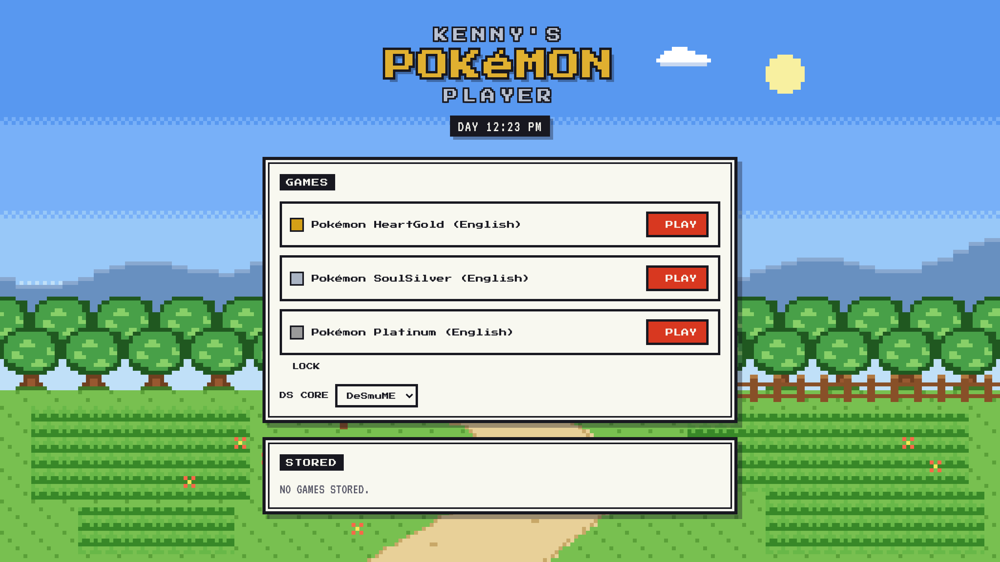

# Kenny's Pokémon Player

**Your DS Pokémon games, in any browser, with your saves following you and a live guide that knows where you are.**



Kenny's Pokémon Player is a private, bring-your-own-ROM player for Gen 4 Pokémon, built for
HeartGold and SoulSilver. Open the page, enter your password, press **PLAY**. No installs, no
emulator settings, no hunting for save files. Behind the Game Boy Color–style front end is a
full DS emulator plus a set of tools that read the game as you play.

**Live:** [pokemon-90a.pages.dev](https://pokemon-90a.pages.dev) (password protected)

## Why it's different

### 🗺️ A guide that follows you
While you play HeartGold or SoulSilver, a panel beside the game reads the DS memory and shows the
place you're standing in, updated as you move:

- **Live mini map** drawn from the terrain in your own ROM, with exits, doors, building names on the
  roofs, and every item and trainer spot marked.
- **Items**, with hidden ones flagged so you never miss a Heart Scale again.
- **Wild Pokémon** for grass (morning, day and night), surfing, fishing and Rock Smash, with levels and rates.
- **Trainers** and their teams, with the ones you've already beaten greyed out.
- **NEXT:** the story step you're on, walked through from your save's progress flags, with the boss's
  team and what each of their Pokémon is weak to.
- **Wild IV rating:** the Pokémon you're battling is decoded on the spot and its IVs are graded, so you
  know whether it's worth catching.

### ☁️ Saves that are never lost
- Every in-game save is backed up to the cloud every 30 seconds, when you switch tabs and when you exit.
- Each device keeps its own slot, and the last 20 versions are kept as backups.
- If this browser has a newer save than the cloud, the page asks which one to keep. Nothing is
  overwritten silently.
- Saves are restored before the game boots, so **Continue** just works.

### ⚡ Less grind, more adventure
Built-in quality-of-life tweaks for HeartGold and SoulSilver, applied live in memory. Your ROM and
save files are never modified.

- **Always-on Exp. Share** for the whole party: fighters get 130% of the EXP, the bench gets 100%.
- **Tougher trainers** at +5 levels to match, so battles stay interesting.
- **HP bars drain 2× faster** and a **Speed** button fast-forwards the slow parts.
- **More Master Balls:** earn one for a shiny, a near-perfect or a lucky wild Pokémon, or for winning the
  Bug-Catching Contest. Goldenrod Dept. Store 2F sells them too (₽100,000).

### 🎮 Instant library
- Your games live in private cloud storage and appear the moment you sign in, with their real title and
  region read straight from the cartridge header.
- The first play caches the game in your browser, so every launch after that is instant.
- One password, a 30-day session, and changing the password signs out every device.

### 🌅 A front end with a sense of place
Original pixel art in the style of Gold and Silver: a hand-built background scene that moves through
morning, day and night with your clock, chunky text boxes and the Press Start 2P typeface.

## Built on

- [EmulatorJS](https://emulatorjs.org) with the DeSmuME core (melonDS can be picked on the main page).
- One static page and plain JavaScript. No framework, no bundler, no build step.
- Cloudflare Pages for hosting, Pages Functions for the API, and a private R2 bucket for games and saves.
- Guide data generated from the [pret/pokeheartgold](https://github.com/pret/pokeheartgold) decompilation.

## Bring your own games

No games are included, and the site never hosts or serves one publicly. You upload your own
legally dumped ROMs to your private R2 bucket, and they're only ever sent to a signed-in session.
Pokémon is a trademark of Nintendo, Creatures and Game Freak. This project isn't affiliated with or
endorsed by them.

## Run it yourself

### Locally

```
python3 -m http.server 8000      # on Windows: py -m http.server 8000
```

Open http://localhost:8000. The API isn't available there; to try it with sign-in and cloud
storage, run `npx wrangler pages dev . --r2 ROMS=roms-test --binding SITE_PASSWORD=<your password> --port 8788`.

### Deploy to Cloudflare Pages

1. Create a Pages project from this repo: framework preset **None**, no build command, output directory `/`.
2. Create a private R2 bucket and bind it to the project as `ROMS`.
3. Add an encrypted environment variable `SITE_PASSWORD`.
4. Upload your ROMs to the bucket (R2 > bucket > Upload). They show up after a page reload.

Every push to `main` deploys automatically.

## Learn more

Design notes live in [`docs/`](docs): [design](docs/design.md), [emulator](docs/emulator.md),
[save sync](docs/save-sync.md), [guide panel](docs/guide-panel.md), [Exp. Share](docs/exp-share.md),
[Master Balls](docs/master-balls.md) and [testing](docs/testing.md).
